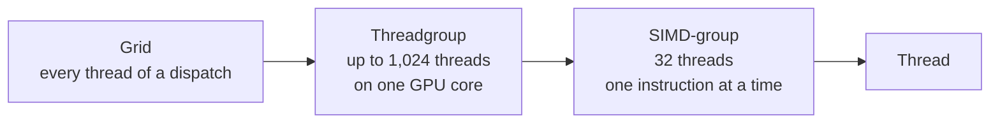
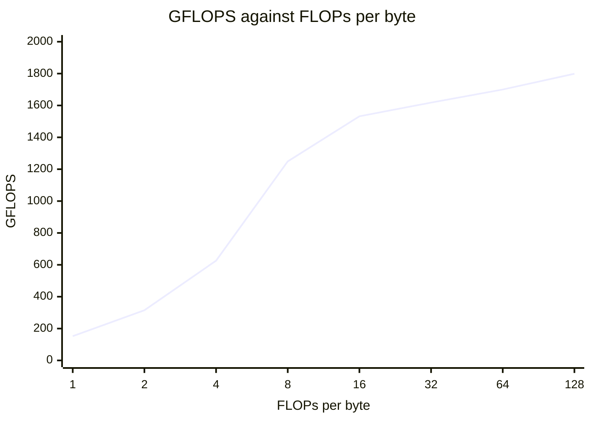

# GPU fundamentals

Sources:
- [Creating threads and threadgroups](https://developer.apple.com/documentation/metal/creating-threads-and-threadgroups)
- [Calculating threadgroup and grid sizes](https://developer.apple.com/documentation/metal/calculating-threadgroup-and-grid-sizes)
- [Metal Shading Language Specification](https://developer.apple.com/metal/Metal-Shading-Language-Specification.pdf)
- [Metal Compute on MacBook Pro](https://developer.apple.com/videos/play/tech-talks/10580/)
- [Scale compute workloads across Apple GPUs](https://developer.apple.com/videos/play/wwdc2022/10159/)
- [Roofline: An Insightful Visual Performance Model](https://doi.org/10.1145/1498765.1498785)
- [`numpy.sum`](https://numpy.org/doc/stable/reference/generated/numpy.sum.html)

Every number here was measured on an M1 Pro with 14 GPU cores.

## Throughput, not speed

A CPU core is built to finish one thread's work as soon as possible. A GPU is
built to finish a lot of work, and doesn't mind when any single thread
finishes.

The difference shows when a thread reads memory. RAM is far from the core, so
a read takes a long time to come back compared with arithmetic. A CPU spends
much of its chip hiding that wait for one thread: large caches, guessing which
way a branch will go, running later instructions early. A GPU core keeps many
threads loaded at once instead. When one is waiting for memory, the core runs
another. With enough threads loaded, something is always ready to run, and the
waiting disappears behind other work.

That's why a kernel runs one thread per element, not a few threads that loop,
threads keep the GPU busy. For a complex kernel, Apple's rule of thumb is
1,000 to 2,000 threads per GPU core. This M1 Pro has 14 cores, so a grid
needs 14,000 to 28,000 threads before every core is busy. A smaller grid
leaves cores unoccupied.

## The execution hierarchy

A dispatch is a grid of threads, cut into threadgroups (note 08). Apple's
WWDC22 talk describes what happens next:

> Threadgroups are uniformly distributed to the GPU cores and have access to
> threadgroup memory, which is limited in size, but very fast, local to the GPU
> core. A single threadgroup is further broken down into SIMD-groups.



A threadgroup runs on one core from start to finish. That's what lets its
threads share memory, the memory on that core.

Sharing costs more the higher it goes: cheapest within a SIMD-group, then fast
memory and a barrier within a threadgroup, RAM and a second dispatch across the
grid.

### An example

`run` with `threads=100_003` and a kernel whose limit is 1,024:

```
grid: 100,003 threads
├─ threadgroups 0–96: 1,024 threads each, 32 SIMD-groups of 32
└─ threadgroup 97:    675 threads, 21 full SIMD-groups and one of 3
```

The 98 threadgroups go to the 14 cores, 7 each on average, as cores free up.

A thread can read where it sits through attributes on the kernel's
parameters. For the thread at 5,000 in the grid:

| Attribute                        | Value | From            |
| -------------------------------- | ----- | --------------- |
| `thread_position_in_grid`        | 5000  |                 |
| `threadgroup_position_in_grid`   | 4     | 5000 // 1024    |
| `thread_position_in_threadgroup` | 904   | 5000 − 4 × 1024 |
| `simdgroup_index_in_threadgroup` | 28    | 904 // 32       |
| `thread_index_in_simdgroup`      | 8     | 904 − 28 × 32   |

### The size of a threadgroup

A dispatch chooses its threadgroup size, up to the kernel's limit. Apple's
"Calculating threadgroup and grid sizes" shows how to launch the largest one.
The WWDC22 talk recommends small ones, to balance the work between cores:

> It's best to use the smallest multiple of the SIMD width that maps well to
> your workload. By using smaller threadgroups, the GPU has more opportunities
> to better balance its workload.

The grid above is 98 threadgroups of up to 1,024 threads, or 3,126 of up to 32.
With more, smaller threadgroups, a slow one holds up less of the work. That
matters most when some threads do much more work than others. Larger
threadgroups let more threads share threadgroup memory.

## SIMD-groups

SIMD stands for single instruction, multiple data. The 32 threads of a
SIMD-group don't each follow their own instructions. The core issues one
instruction, and all 32 threads carry it out at once, each on its own data.
`c[i] = a[i] + b[i]` is one add, done 32 times side by side. Other GPUs call
the same thing a warp or a wavefront.

`threadExecutionWidth` is the size of a SIMD-group, and it's 32 on every Apple
GPU.

A SIMD-group is always a run of 32 consecutive threads, counted along `x`
first. Each thread can read where it sits:

```metal
uint sg   [[simdgroup_index_in_threadgroup]]   // which SIMD-group
uint lane [[thread_index_in_simdgroup]]        // which thread in it, 0 to 31
```

In a 1D threadgroup of 1,024 threads, threads 0–31 are SIMD-group 0, threads
32–63 are SIMD-group 1, and so on up to SIMD-group 31. In the 32 × 32
threadgroup metalloid uses for 2D grids, each row is one SIMD-group: row 5 is
SIMD-group 5, with lanes 0 to 31 from left to right.

### Divergence

One instruction stream means an `if` can't send a SIMD-group's threads two ways
at once. Apple's page:

> Even if a single thread in a SIMD group takes a different path from the
> others, all threads in that group execute both branches, and the execution
> time for the group is the sum of the execution time of both branches.

The threads on the other path are switched off while each branch runs, so
the results are still right. Only the time goes up.

What matters is whether a SIMD-group splits, not how many threads take each
branch. `if (i % 2)` sends half the threads each way and splits every
SIMD-group, so each one pays for both branches. `if ((i / 32) % 2)` also sends
half each way, but whole SIMD-groups go together, so each runs one branch and
pays nothing extra. A bounds check such as `if (i < n)` splits at most the one
SIMD-group that straddles `n`.

## Memory

A kernel has four places to put data, called address spaces (MSL spec,
section 4):

| Address space | Seen by                        | Lives in                          |
| ------------- | ------------------------------ | --------------------------------- |
| `device`      | every thread, and the CPU      | RAM, as an `MTLBuffer`            |
| `constant`    | every thread, read-only        | RAM, from a buffer or `setBytes`  |
| `threadgroup` | the threads of one threadgroup | the GPU core                      |
| `thread`      | one thread                     | registers, or memory when spilled |

A variable declared inside a kernel, like `float x`, is in `thread` space.
It normally sits in registers. When a kernel needs more than it can get, or
indexes a local array with a value the compiler can't know, the compiler may
spill the data to memory, which is slower.

Pointers have to name their address space, which is why every buffer argument
so far has named `device` or `constant`.

From fastest to slowest: registers, threadgroup memory, then RAM. Reads from
RAM go through a cache on the GPU, which is much faster than RAM but small.

### Neighbours read together

Memory isn't fetched one float at a time. The GPU fetches whole blocks, called
cache lines, and keeps them in the cache. A thread that wants 4 bytes still
gets the whole block they sit in.

When the 32 threads of a SIMD-group read 32 neighbouring floats, those 128
bytes arrive in a few blocks, and every byte fetched gets used. When they read
floats far apart, each float sits in a different block. Each thread needs a
block of its own, uses 4 bytes of it, and the rest is wasted.

While neighbouring threads read less than a block apart, they share blocks, and the
farther apart they read, the more blocks a SIMD-group fetches. Once they read a
block or more apart, each thread fetches a block of its own, and spreading the
reads farther fetches no more.

This is why metalloid's 2D threadgroups are 32 wide. A row of the threadgroup is
one SIMD-group, and in C order the elements of a row sit next to each other in
memory (note 09).

### Threadgroup memory

A kernel declares threadgroup memory like a local array, with `threadgroup` in
front:

```metal
threadgroup float shared[1024];
```

Each threadgroup gets its own copy, which exists only while that threadgroup
runs. Threads in different SIMD-groups hand each other data through it without
going through RAM. Threads in the same SIMD-group can also use SIMD-group
functions, which need no memory (see Contention).

There's little of it: 32 KiB per threadgroup on this GPU, or 8,192 floats. One
more float and the kernel doesn't compile:

```
Threadgroup memory size (32772) exceeds the maximum threadgroup memory allowed (32768)
```

## Barriers

The threads of one SIMD-group move together, but the SIMD-groups of a
threadgroup don't. If thread 40 reads what thread 0 wrote to threadgroup
memory, nothing guarantees thread 0 has written it yet. A barrier makes the
threads wait for each other:

> All threads in a threadgroup executing the kernel [...] need to execute this
> function before any thread can continue execution beyond the
> threadgroup_barrier.

Reversing each threadgroup's block of an array needs one barrier, so that no
thread reads `shared` before every thread has written to it:

```metal
kernel void reverse(device float *x [[buffer(0)]],
                    uint i [[thread_position_in_grid]],
                    uint l [[thread_position_in_threadgroup]],
                    uint size [[threads_per_threadgroup]])
{
    threadgroup float shared[1024];
    shared[l] = x[i];
    threadgroup_barrier(mem_flags::mem_threadgroup);
    x[i] = shared[size - 1 - l];
}
```

`mem_flags::mem_threadgroup` says which memory has to be up to date when the
threads continue: here, the writes to `shared`.

The spec sets one rule for where a barrier can go. If any thread reaches it,
*every* thread of the threadgroup has to. A barrier inside an `if` that only
some threads enter breaks that. On Apple silicon, a thread that has already
ended doesn't hold the others back.

`simdgroup_barrier` does the same for one SIMD-group. SIMD-group functions need
no barrier, but ordinary memory shared within a SIMD-group does.

A barrier only reaches as far as the threadgroup. Nothing in a kernel can make
one threadgroup wait for another. They run on different cores and finish at
different times, and a large grid has more threadgroups than the GPU holds at
once, so some haven't started when others are done. Writes to `device` memory
are guaranteed visible only inside the threadgroup that made them (spec,
section 4.8). To combine what different threadgroups computed, the dispatch
has to end and another has to start, or the threads have to use atomic
operations, which are made for exactly this.

## Atomics

`count[0] += 1` is three steps: read, add, write. Threads that read at the
same moment all write back the same value:

```metal
kernel void count(device uint *c [[buffer(0)]]) { c[0] += 1; }
```

Each thread runs the kernel once, so 2^24 threads should leave `c[0]` at
2^24. It ends at 1. The threads kept overwriting each other's adds, and only
one of them stuck.

An atomic operation does the read, change, and write as one step that no
other thread can split. The memory is declared atomic, and changed only
through atomic functions:

```metal
kernel void count(device atomic_uint *c [[buffer(0)]]) {
    atomic_fetch_add_explicit(c, 1u, memory_order_relaxed);
}
```

That ends at 2^24.

`memory_order_relaxed` makes the add itself safe and says nothing about the
thread's other memory. The spec, section 6.16.1:

> A typical use for relaxed memory ordering is updating counters, such as
> reference counters because this only requires atomicity, but neither
> ordering nor synchronization.

Stronger orders, `memory_order_acquire` and `memory_order_release`, exist
for when one thread has to see everything another wrote before its atomic.

### Contention

An atomic reads, changes, and writes as one step, so two atomics on the same
address can't overlap: the second waits until the first has written, or it
would read the old value. Atomics on one address happen one after another,
however many cores the GPU has.

When many threads use the same address, they wait for each other. This is
contention. 2^24 threads adding 1 to one counter make 2^24 adds in a row.

The fix is fewer atomics on that address. The 32 threads of a SIMD-group add
their values together with `simd_sum`, without memory, and one of them does a
single atomic for all 32:

```metal
kernel void count(device atomic_uint *c [[buffer(0)]],
                  uint lane [[thread_index_in_simdgroup]]) {
    uint total = simd_sum(1u);
    if (lane == 0) {
        atomic_fetch_add_explicit(c, total, memory_order_relaxed);
    }
}
```

That's 32 times fewer atomics. It's only correct when all 32 threads add to
the same address: a SIMD-group whose threads add to different counters can't
put its total in one of them.

Apple's WWDC22 talk suggests going further with threadgroup atomics. Each
SIMD-group adds its total to a counter in threadgroup memory, a barrier waits
for all of them, and one thread per threadgroup does a single atomic in device
memory. With 1,024 threads per threadgroup, 2^24 threads make 16,384 device
atomics instead of 524,288.

The `count` kernel in Atomics doesn't need this. Every thread there adds to
`c[0]`, and the adds are combined automatically, most likely by the compiler,
which can see the address is the same for every thread. With `n` passed in as
1, `c[i % n]` is also always `c[0]`, but the compiler can't know that `n` is 1,
and the adds go one at a time.

2^24 threads, one counter:

| Address                                          | Time    |
| ------------------------------------------------ | ------- |
| `c[0]`                                           | 1.0 ms  |
| `c[i % n]`, n = 1                                | 24.7 ms |
| `c[i % n]`, one atomic per SIMD-group (simd_sum) | 1.0 ms  |

## Occupancy

Each GPU core has a fixed number of registers and a fixed amount of
threadgroup memory, and every thread loaded on the core takes its share. A
kernel that needs more registers per thread leaves room for fewer threads.
Occupancy is the fraction of a core's thread slots in use: the threads it
has loaded, out of the most it could hold. The tech talk:

> Thread memory is backed by registers, and as the pressure for registers
> increases, occupancy can be decreased to accommodate.

Fewer threads loaded means fewer to switch to while one waits for memory, the
thing that made the GPU fast in the first place.

Registers also limit the size of a threadgroup. A threadgroup runs on one core
with all its threads loaded at once, so the more registers each thread needs,
the fewer threads one threadgroup can have. The pipeline reports the limit as
`maxTotalThreadsPerThreadgroup`, which is why `run` asks the kernel for its
limit rather than assuming 1,024.

The limit is per threadgroup. It says how large one threadgroup can be, not
how many threads a core holds.

A core runs as many threadgroups at once as fit. Each takes its threads,
its threadgroup memory, and its threads' registers, and the core stops
taking more when any of the three runs out. Apple publishes only the limits
per threadgroup, not how much a core has, so a kernel that asks for more
threadgroup memory or more registers gets fewer threadgroups at once.

## Two limits

A kernel is held back by one of two things: how fast the GPU does arithmetic,
or how fast memory delivers bytes.

Arithmetic is counted in floating-point operations, FLOPs. The arithmetic in
this section is fused multiply-adds, FMAs: `fma(a, b, c)` computes `a * b + c`
in one instruction. "Fused" means it rounds once, at the end. The spec:

> Returns the correctly rounded floating-point representation of the sum of c
> with the infinitely precise product of a and b. Rounding of intermediate
> products shall not occur.

Written as `a * b + c` with two operations, the product is rounded to a float,
then the sum is rounded again. `fma` skips the first rounding, so the result is
the float nearest the exact answer. By default the compiler may turn `a * b + c`
into an `fma` on its own (spec, section 1.6.3). An FMA is a multiply and an add,
so it counts as two FLOPs.

Which limit a kernel hits depends on its operational intensity: the FLOPs it
does per byte it moves to and from RAM. At low intensity the arithmetic
finishes before the bytes arrive, and the kernel waits on memory. At high
intensity memory waits on the arithmetic. The intensity where the two meet is
the ridge point, the arithmetic peak divided by the bandwidth.

A kernel that reads a `float4` (a vector of four 32-bit floats, 16 bytes, not a
single float), does `k` rounds of 16 FMAs on it, and writes a `float4` does `k`
FLOPs per byte. A sweep runs it at several values of `k` and keeps everything
else the same. Over 2^24 `float4`s:



The roofline paper plots both axes in logarithms, so its slope is a straight
line. This chart's y axis is linear, so the slope curves.

Up to 8 FLOPs per byte the time stays at about 3.4 ms: memory is the limit, and
the arithmetic fits inside the wait for it, so the same time holds more FLOPs.
From 16 on, arithmetic is the limit: doubling it takes about 1.9 times as long.
The rate still climbs 5 to 6% with each doubling, up to 1.8 TFLOPS at 128.

A rising slope where memory limits and a flat roof where arithmetic does is the
[roofline model](https://doi.org/10.1145/1498765.1498785). Its roof is the
GPU's peak arithmetic rate. This loop hasn't leveled off, so its 1.8 TFLOPS is
a lower bound on the peak, not the roof itself. The bend between 8 and 16 FLOPs
per byte is where this loop stops being limited by memory. The GPU's ridge
point is at least that far right, and farther if the peak is higher.

`add` reads 8 bytes and writes 4 for one FLOP: 1/12 of a FLOP per byte, far
left of the ridge. Most elementwise kernels sit there. Bandwidth sets the most
they can reach, so what helps is moving fewer bytes, with smaller types or by
doing two steps in one kernel. Up to the bend, extra arithmetic costs almost
nothing: in the sweep, 1 and 8 FLOPs per byte took about the same time.

### Measuring it

The GPU raises its clock only once it has been busy for a while, so a run after
a pause is slower than the same run back to back. The sweep's numbers are the
median of runs repeated back to back for a second, from the second half, after
the clock has settled. The script is in Reproducing the numbers.

## The CPU and the GPU

Every dispatch the CPU waits for pays a fixed cost: encoding, committing, the
GPU starting the work, and the CPU learning it's done. An empty kernel on one
thread takes about 220 µs from Python.

Adding two float32 arrays, buffers made in advance, timed back to back as in
Measuring it. Each value is the median of three runs of the script:

| Elements    | GPU     | NumPy   |
| ----------- | ------- | ------- |
| 1,000       | 222 µs  | 0.4 µs  |
| 100,000     | 232 µs  | 9.9 µs  |
| 1,000,000   | 266 µs  | 114 µs  |
| 10,000,000  | 0.94 ms | 1.57 ms |
| 100,000,000 | 7.1 ms  | 15.8 ms |

Up to a million elements, NumPy finishes before the GPU's fixed cost is paid.
By 10 million, the GPU is ahead. At 100 million the GPU moves its 1.2 GB at 169
GB/s and NumPy at 76 GB/s, so the GPU is 2.2 times faster. The GPU's rate is
close to the sweep's 156 GB/s, so `add` looks memory-bound there. NumPy adds on
one CPU thread, so its rate isn't the CPU's limit.

Unified memory removes copying, not waiting. What pays off is fewer, larger
dispatches.

## Floating point

### No `double`

The spec, section 2.1:

> Metal does not support the double, long long, unsigned long long, and long
> double data types.

`device double *x` fails to compile with `'double' is not supported in Metal`.
NumPy makes float64 by default, so an array bound for a `float` kernel has to be
converted first, for example with `a.astype(np.float32)`. A float64 array
copied into a buffer as it is still holds 8-byte values, and a kernel reading
`float` reads each as two meaningless halves.

### Fast math is the default

`MTLLibrary.h` on the compile options:

> Sets the default math functions for single precision floating-point.
> Default is `MTLMathFloatingPointFunctionsFast`.

A kernel compiled without options gets this default, so its `sin` is the fast
`sin`. `precise::sin` and `fast::sin` pick one explicitly. The spec's tables 8.1
and 8.2 give each a bound:

| Function            | Spec bound           |
| ------------------- | -------------------- |
| `sin`, x in [−π, π] | 2^-13 absolute error |
| `sin`, any other x  | "larger otherwise"   |
| `precise::sin`      | 4 ulp                |
| `exp`               | 3 + ⌊\|2x\|⌋ ulp     |
| `precise::exp`      | 4 ulp                |

2^-13 is about 0.000122, so for x in [−π, π] fast `sin` is right to about 3
decimal places. The bound is absolute, so it says little near zero: at
x = 0.001 it is 12% of the answer. For any other x, the spec says only that the
error is "larger otherwise" and gives no bound.

An ulp ("unit in the last place") is the distance from one float to the next
float after it, so 4 ulp means the last few bits may be wrong. Each single `+`,
`−`, `×`, and `fma` is correctly rounded either way. Division is within 2.5 ulp
under fast math, for a divisor from 2^-126 to 2^126.

A separate option, `mathMode`, covers arithmetic. The spec says its default is
also fast, which lets the compiler assume no value is ever infinite or NaN
(section 1.6.3):

> If the program has an expression X/Y, the compiler can assume Y is never
> zero as this could potentially result in positive/negative infinite or NaN,
> depending on the value of X. If Y can be zero, you would have an undefined
> program if compiled with fast math.

The math functions are the exception. From Apple GPU family 4, even the fast
ones honor INF and NaN.

### Order changes the sum

A float addition can round, so `(a + b) + c` and `a + (b + c)` can differ.
Ten million float32 copies of 0.1 (which is 0.10000000149 as a float32):

| Added                              | Result         |
| ---------------------------------- | -------------- |
| exactly                            | 1,000,000.0149 |
| `np.sum`, partly in pairs          | 1,000,000.125  |
| one at a time into a running total | 1,087,937      |

The running total drifts because, once it's large, each 0.1 is rounded to the
nearest float that total can hold. Pairing keeps the two sides of each
addition of similar size. `np.sum` pairs:

> However, often numpy will use a numerically better approach (partial
> pairwise summation) leading to improved precision in many use-cases.

A GPU sum adds in yet another order, SIMD-group by SIMD-group and threadgroup
by threadgroup, so its last digits can differ from `np.sum`'s. Inside a kernel,
fast math also lets the compiler reassociate the additions (section 1.6.3). The
spec says this "may dramatically change the floating-point results". Results
are compared within a tolerance, such as `np.testing.assert_allclose`, never
for equality.

## Where this leads

Summing an array needs every element to meet, and the levels above decide how:

- **Within a SIMD-group**, `simd_sum` adds the 32 threads' values and gives
  every thread the total, with no memory and no barrier.
- **Within a threadgroup**, each SIMD-group writes its total to threadgroup
  memory, a barrier waits for all of them, and one SIMD-group adds those.
- **Across threadgroups**, there's no barrier. Each threadgroup writes its
  total to device memory, and a second dispatch adds those.

## Reproducing the numbers

The scripts run on any Mac with Apple silicon. On another chip, expect other
numbers and the same shapes. The GPU scripts run after this setup:

```py
import time

import numpy as np

from metalloid import Device

device = Device()


def steady(kernel, args, threads):
    """Run back to back for a second, the median of the second half."""
    times = []
    end = time.perf_counter() + 1
    while time.perf_counter() < end:
        start = time.perf_counter()
        device.run(kernel, args, threads)
        times.append(time.perf_counter() - start)
    return np.median(times[len(times) // 2 :])
```

### Atomics

```py
library = device.compile("""
#include <metal_stdlib>
using namespace metal;

kernel void plain(device uint *c [[buffer(0)]]) { c[0] += 1; }

kernel void with_atomic(device atomic_uint *c [[buffer(0)]]) {
    atomic_fetch_add_explicit(c, 1u, memory_order_relaxed);
}
""")

for name in ("plain", "with_atomic"):
    c = device.new_buffer_from(np.zeros(1, np.uint32))
    device.run(library.kernel(name), [c], 2**24)
    print(name, c.numpy()[0])
```

### Contention

```py
library = device.compile("""
#include <metal_stdlib>
using namespace metal;

kernel void fixed(device atomic_uint *c [[buffer(0)]]) {
    atomic_fetch_add_explicit(&c[0], 1u, memory_order_relaxed);
}

kernel void computed(device atomic_uint *c [[buffer(0)]],
                     constant uint &n [[buffer(1)]],
                     uint i [[thread_position_in_grid]]) {
    atomic_fetch_add_explicit(&c[i % n], 1u, memory_order_relaxed);
}

kernel void combined(device atomic_uint *c [[buffer(0)]],
                     constant uint &n [[buffer(1)]],
                     uint i [[thread_position_in_grid]],
                     uint lane [[thread_index_in_simdgroup]]) {
    uint total = simd_sum(1u);
    if (lane == 0) atomic_fetch_add_explicit(&c[i % n], total, memory_order_relaxed);
}
""")

c = device.new_buffer(1, np.uint32)
for name in ("fixed", "computed", "combined"):
    t = steady(library.kernel(name), [c, np.uint32(1)], 2**24)
    print(f"{name}: {t * 1e3:.1f} ms")
```

### Two limits

```py
library = device.compile("""
#include <metal_stdlib>
using namespace metal;

// k rounds of 16 FMAs, on four float4s. Each round uses the last one's results,
// so the compiler can't drop any.
kernel void sweep(device const float4 *in [[buffer(0)]],
                  device float4 *out [[buffer(1)]],
                  constant uint &k [[buffer(2)]],
                  uint i [[thread_position_in_grid]]) {
    float4 a = in[i], b = a + 1, c = a + 2, d = a + 3;
    for (uint j = 0; j < k; j++) {
        a = fma(a, 0.999f, 0.5f);
        b = fma(b, 0.999f, 0.5f);
        c = fma(c, 0.999f, 0.5f);
        d = fma(d, 0.999f, 0.5f);
    }
    out[i] = a + b + c + d;
}
""")

n = 2**24
x = device.new_buffer_from(np.ones((n, 4), np.float32))
y = device.new_buffer((n, 4), np.float32)

for k in (1, 2, 4, 8, 16, 32, 64, 128):
    t = steady(library.kernel("sweep"), [x, y, np.uint32(k)], n)
    print(f"{k:3} FLOPs per byte: {t * 1e3:5.2f} ms, {n * k * 32 / t / 1e9:4.0f} GFLOPS")
```

### The CPU and the GPU

```py
library = device.compile("""
#include <metal_stdlib>
using namespace metal;

kernel void empty() {}

kernel void add(device const float *a [[buffer(0)]],
                device const float *b [[buffer(1)]],
                device float *out [[buffer(2)]],
                uint i [[thread_position_in_grid]]) {
    out[i] = a[i] + b[i];
}
""")

print(f"empty: {steady(library.kernel('empty'), [], 1) * 1e6:.0f} µs")

for n in (10**3, 10**5, 10**6, 10**7, 10**8):
    a, b = np.ones(n, np.float32), np.ones(n, np.float32)
    out = np.zeros(n, np.float32)
    buffers = [
        device.new_buffer_from(a),
        device.new_buffer_from(b),
        device.new_buffer(n, np.float32),
    ]
    gpu = steady(library.kernel("add"), buffers, n)

    times = []
    end = time.perf_counter() + 1
    while time.perf_counter() < end:
        start = time.perf_counter()
        np.add(a, b, out=out)
        times.append(time.perf_counter() - start)
    cpu = np.median(times[len(times) // 2 :])

    print(f"{n:>11,}: GPU {gpu * 1e6:8.0f} µs, NumPy {cpu * 1e6:8.1f} µs")
```

### Order changes the sum

```py
import numpy as np

x = np.full(10**7, 0.1, np.float32)

print(f"exactly:       {10**7 * float(x[0]):,.4f}")  # float64 holds a float32 exactly
print(f"np.sum:        {np.sum(x):,.3f}")
print(f"running total: {np.cumsum(x)[-1]:,.0f}")  # each prefix, one add at a time
```
