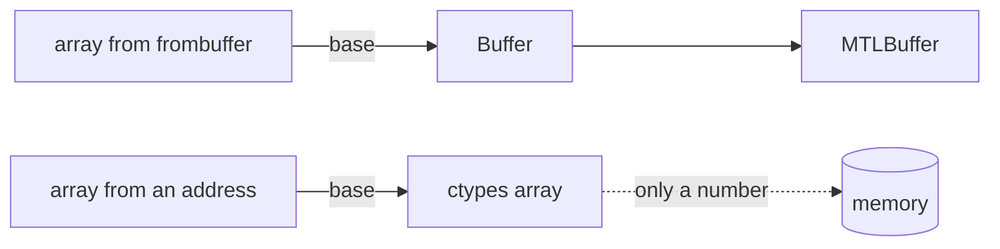

# How a NumPy array keeps its memory alive

Sources:
- [`ndarray.base`](https://numpy.org/doc/stable/reference/generated/numpy.ndarray.base.html)
- [`sys.getrefcount`](https://docs.python.org/3/library/sys.html#sys.getrefcount)

## `base`

Every NumPy array has a `base` attribute:

> Base object if memory is from some other object.

An array that allocated its own memory has `base = None`. An array that
borrowed memory, such as a slice or `np.frombuffer(x)`, has the lender in
`base`.

Storing it there is an ordinary Python reference, the same as `y = x`. Python
frees an object only when nothing refers to it, so while the array exists, the
lender can't be freed.

## Watching it

`sys.getrefcount` reports how many references an object has, plus one for its
own argument:

```py
buf = Device().new_buffer(16)
sys.getrefcount(buf)                  # 2: our variable

arr = np.frombuffer(buf, dtype=np.float32)
sys.getrefcount(buf)                  # 3: our variable and arr.base
arr.base is buf                       # True

del arr
sys.getrefcount(buf)                  # 2: back to our variable
```

## What `np.frombuffer` does

1. Asks the object for its memory. For a `Buffer`, Python calls
   `buf.__buffer__()`, which returns a `memoryview` over the bytes.
2. Reads the address and size from it and builds an array over those bytes,
   without copying.
3. Stores the object in the array's `base`.
4. When the array is freed, drops `base`, and the object's count goes down.

## Why a bare address isn't enough

An address is just an `int`. Python tracks references between objects, not
what numbers might point to. An array built from an address has a `base` too,
but it is a ctypes array that holds only that number:



In the second case only your own variable keeps the `Buffer` alive. Once it's
gone, the `Buffer` is freed, its `Object` releases the `MTLBuffer` (note 04),
and Metal frees the memory. The array still holds the old address, which now
points at freed memory, with no error to warn you.
