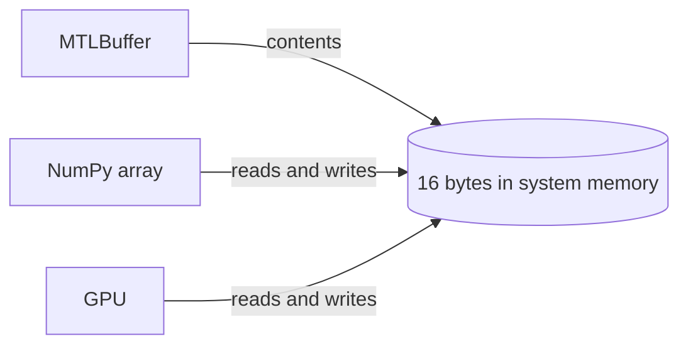

# 06 · Buffers

Sources:
- [`newBufferWithLength:options:`](https://developer.apple.com/documentation/metal/mtldevice/makebuffer(length:options:))
- [Python: emulating buffer types](https://docs.python.org/3/reference/datamodel.html#emulating-buffer-types)
- [`numpy.frombuffer`](https://numpy.org/doc/stable/reference/generated/numpy.frombuffer.html)

## What a buffer is

A buffer is a block of bytes the GPU can read and write. That's all Metal
knows about it:

> The Metal framework doesn't know anything about the contents of an
> `MTLBuffer`, just its size. You define the format of the data in the buffer.

What the bytes mean, float32 or int8, one row or a 3×4 grid, is up to us. That
is exactly what a NumPy array adds: a `dtype` and a `shape` on top of raw
memory. So a buffer and an array fit together naturally.

## Creating one

```objc
- (nullable id <MTLBuffer>)newBufferWithLength:(NSUInteger)length
                                       options:(MTLResourceOptions)options;
```

Apple's page sums it up as "Creates a buffer the method clears with zero
values." Reading the declaration the usual way:

- **`new`**: we own the buffer, so it goes in `Object(ptr, owned=True)`.
- **`nullable`**: it returns nil when it fails. That happens for 0 bytes and
  for anything over the device's `maxBufferLength`. One byte over is enough.
- **`options`**: where the memory lives. We always pass
  `MTLResourceStorageModeShared`, which is `0`.

## Shared memory

The CPU and GPU share access to the resource, allocated in system memory.

On Apple silicon there is only one memory, so "shared" is literal: the CPU and
GPU read the same bytes, not copies. The buffer's `contents` gives the CPU
their address:

> Gets the system address of the buffer's storage allocation.



Writing `[1.5, 2.5, 3.5, 4.5]` through a NumPy array and reading the same
address through Metal's pointer gives back `[1.5, 2.5, 3.5, 4.5]`. Same
memory, nothing copied.

Sharing has one rule, and it's ours to follow:

> Ensure that all changes you schedule on either the CPU or GPU for a resource
> that uses shared memory complete before accessing that resource on the other
> processor.

In practice: don't read an array while a GPU job that writes it is still
running. Dispatch, wait, then read.

## Handing the memory to NumPy

### The trap

The obvious way is to point NumPy straight at `contents`. It works until the
buffer goes away:

```py
array = numpy_view_of(buffer.contents)
del buffer          # Metal frees the memory
array[0]            # reads freed memory: no error, just garbage
```

The array only has an address. It doesn't know the address belongs to a Metal
buffer, so nothing keeps the buffer alive.

**The array needs to hold on to the buffer itself.**

### How Python lends memory

Python frees an object once nothing refers to it. So to keep the buffer alive,
the array only has to refer to it.

Python already has a way for one object to use another's memory: the *buffer
protocol*. It's a standard request, "let me use your raw bytes", and `bytes`,
`bytearray`, and NumPy arrays all answer it. When NumPy borrows memory this
way, it keeps a reference to the lender:

```py
data = bytearray(4)                           # bytearray(b'\x00\x00\x00\x00')
array = np.frombuffer(data, dtype=np.uint8)   # borrows data's 4 bytes
array[0] = 7
data                                          # bytearray(b'\x07\x00\x00\x00')
```

Nothing was copied: the write through `array` landed in `data`. And because
`array` refers to `data`, `data` lives as long as the array does. NumPy's
documentation says it in one line:

> This function creates a view into the original object.

### Making `Buffer` a lender

A class of our own answers the same request by defining `__buffer__`:

> `object.__buffer__(self, flags)`: Called when a buffer is requested from
> *self* \[...\] The method must return a `memoryview` object.

A `memoryview` is Python's handle on a block of raw memory. `Buffer` returns
one over the bytes at `contents`:

```py
class Buffer:
    def __buffer__(self, flags):
        return memoryview(the 16 bytes at contents)

    def numpy(self, dtype, shape=-1):
        return np.frombuffer(self, dtype=dtype).reshape(shape)
```

`np.frombuffer(self)` asks the `Buffer` for its memory, Python calls
`__buffer__`, and the array that comes back refers to the `Buffer`, exactly as
it referred to `data` above.

### The chain

Each object keeps the next one alive:


The array from `numpy()` reaches the `Buffer` through one extra array that
`reshape` creates, but the chain still ends at the `Buffer`.

How `base` holds the reference: [How a NumPy array keeps its memory alive](../background/numpy-base.md).

So the memory lives exactly as long as some array uses it. When the last array
and the `Buffer` are gone, `Object` releases the `MTLBuffer` (note 04).

## Using it

```py
device = Device()
buffer = device.new_buffer(16)          # 16 zeroed bytes

x = buffer.numpy(np.float32)            # array([0., 0., 0., 0.])
x[:] = [1, 2, 3, 4]                     # written straight into GPU memory

grid = buffer.numpy(np.float32, (2, 2)) # another view of the same bytes
grid[1, 1]                              # 4.0
```

Every view is the same memory. A write through one shows up in all of them.

## How big

`maxBufferLength` is a hard limit per buffer. Apple only promises it is at
least 256 MB; on this M1 Pro it is 8.9 GiB. Exactly that much allocates, one
byte more returns nil.

The working set, 11.8 GiB here, is a different number: how much memory the
GPU can use across *all* its buffers before slowing down. So one buffer is
capped at 8.9 GiB, and all of them together should stay under 11.8 GiB.
Apple doesn't say why the two numbers differ.

## Open questions

- The GPU hasn't touched a buffer yet. How does a kernel receive one?
