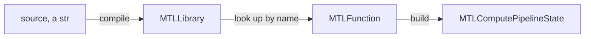

# 07 · Kernels

Sources:
- [`newLibraryWithSource:options:error:`](https://developer.apple.com/documentation/metal/mtldevice/makelibrary(source:options:))
- [Metal Shading Language Specification](https://developer.apple.com/metal/Metal-Shading-Language-Specification.pdf),
  sections 4.1, 5.1.3, 5.2.1, 5.2.3.6

## From code to something the GPU runs

A kernel starts as a Python string and takes three steps to become runnable:



Each step is a `new` method, so we own every result (note 03).

## A first kernel

Kernels are written in the Metal Shading Language, a dialect of C++.

```metal
kernel void add(const device float *a   [[buffer(0)]],
                const device float *b   [[buffer(1)]],
                device float       *out [[buffer(2)]],
                uint i [[thread_position_in_grid]])
{
    out[i] = a[i] + b[i];
}
```

**`kernel void`.** The spec, 5.1.3:

> A compute function (also called a kernel) is a data-parallel function that
> is executed over a 1-, 2-, or 3D grid.

A kernel must return `void`. Its results go out through buffers.

**`device float *a`.** A pointer into a buffer. From 4.1:

> The device address space name refers to buffer memory objects allocated
> from the device memory pool that are both readable and writeable.

Those memory objects are our `MTLBuffer`s from note 06. `const` makes `a` and
`b` read-only.

**`[[buffer(0)]]`.** A numbered slot. When we run the kernel, we'll put a
buffer in slot 0, and that buffer becomes `a`. From 5.2.1:

> The Metal framework API uses this attribute to identify the location for
> these argument types.

**`uint i [[thread_position_in_grid]]`.** The key line. From 5.2.3.6:

> A thread is an instance of the kernel function that executes for each point
> in this grid, and `thread_position_in_grid` identifies its position in the
> grid.

The GPU runs this function once per element, thousands of copies at the same
time, and `i` tells each copy which element is its own.

So there is no loop. In NumPy, `out = a + b` loops for you. In a kernel you
write the body of one iteration, and the GPU runs all of them at once.

## Compiling

```objc
- (nullable id <MTLLibrary>)newLibraryWithSource:(NSString *)source
                                         options:(nullable MTLCompileOptions *)options
                                           error:(__autoreleasing NSError **)error;
```

Two things are new here.

**A string going in.** The source must be an `NSString`. `from_str` makes one,
the mirror of `to_str`. It is autoreleased, so it's used inside a pool.

**An out-parameter.** `NSError *` is a pointer to an error object, and
`NSError **` is a pointer to that pointer. We give Metal the address of an
empty slot, and if compiling fails, Metal writes an error object into it:

```py
error = c_void_p()          # an empty slot: 8 bytes holding NULL
send(device, "newLibraryWithSource:options:error:",
     from_str(source), None, byref(error), ...)
error.value                 # None if it compiled, else the NSError's address
```

`byref(error)` passes the slot's address, not its contents. `__autoreleasing`
means the error is autoreleased, so it's read inside the same pool.

When the source is wrong, the method returns nil and the error's
`localizedDescription` is the compiler's own message. `Device.compile` raises
it as a `CompileError`. Changing `b[i]` to `c[i]` in the kernel above gives:

```
program_source:6:21: error: use of undeclared identifier 'c'
    out[i] = a[i] + c[i];
                    ^
```

## Finding the function

A library can hold many functions.

`newFunctionWithName:` picks one out, or returns nil if no kernel has that name.
That's a different failure from a compile error, with no error object, so
`Library.kernel` raises `KernelNotFoundError`.

## The pipeline

A function is still only compiled code. The pipeline is that code prepared for
this particular GPU, and building it costs time.

> You typically make pipeline states at a noncritical time, like when your app
> first launches. This is because graphics drivers may need time to evaluate
> and build each pipeline state. However, you can quickly use and reuse each
> pipeline state throughout your app's lifetime.

So build a `Kernel` once and keep it. The pipeline also reports two limits
we'll need to run it:

| Property                        | This M1 Pro | Meaning                               |
| ------------------------------- | ----------- | ------------------------------------- |
| `maxTotalThreadsPerThreadgroup` | 1024        | most threads in one threadgroup       |
| `threadExecutionWidth`          | 32          | threads the GPU runs in lock-step     |

The GPU doesn't run threads one by one. It runs them in bundles of 32 that
execute the same instruction together, which the spec calls SIMD-groups:

> For best performance, make the total number of threads in the threadgroup a
> multiple of the `threads_per_simdgroup`.

## Using it

```py
device = Device()
library = device.compile(source)    # CompileError if the source is wrong
add = library.kernel("add")         # KernelNotFoundError if there's no "add"
add.thread_execution_width          # 32
```

## Open questions

- `add` is ready and the buffers exist. How do we put buffers in its slots
  and tell the GPU how many threads to run? See note 08.
