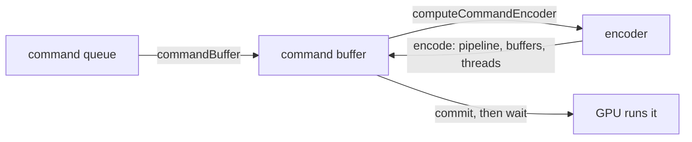

# 08 · Dispatch

Sources:
- [`dispatchThreads:threadsPerThreadgroup:`](https://developer.apple.com/documentation/metal/mtlcomputecommandencoder/dispatchthreads(_:threadsperthreadgroup:))
- [Calculating threadgroup and grid sizes](https://developer.apple.com/documentation/metal/calculating-threadgroup-and-grid-sizes)
- [Metal Feature Set Tables](https://developer.apple.com/metal/Metal-Feature-Set-Tables.pdf)

## How a kernel runs

Calling a Python function runs it immediately. A kernel doesn't run that way.
You encode commands into a command buffer, commit the buffer to a command
queue, and the GPU executes it asynchronously while the CPU carries on. This
is the encode, commit, wait from note 00. It involves three objects:



| Object         | What it is                               | How long it lives          |
| -------------- | ---------------------------------------- | -------------------------- |
| command queue  | schedules command buffers on the GPU     | the whole program          |
| command buffer | holds the encoded commands for one run   | one `run`                  |
| encoder        | encodes commands into a command buffer   | until `endEncoding`        |

## The queue

Like a pipeline, a queue is made once and kept:

> Typically, you create one or more command queues when your app launches and
> then keep them throughout your app's lifetime.

`Device()` makes one with `newCommandQueue`. The name starts with `new`, so
it's ours: `Object(ptr, owned=True)`.

## The command buffer

> A container that stores a sequence of GPU commands that you encode into it.

`commandBuffer` and `computeCommandEncoder` don't start with `new`, so we
don't own what they return. Both are autoreleased, and the whole `run` happens
inside one `autorelease_pool()` (note 03).

A command buffer also holds on to what it uses:

> The command buffers you create with this method maintain strong references
> to the resources you encode into it, including buffers, textures, samplers,
> and pipeline states.

So while the GPU works, our buffers can't be freed under it, even if Python
drops them.

## Encoding

The encoder encodes three commands into the command buffer.

**The pipeline**, the `Kernel` from note 07:

```py
send(encoder, "setComputePipelineState:", kernel, ...)
```

**The buffers**, one per slot. Index `i` here is `[[buffer(i)]]` in the
kernel:

```py
send(encoder, "setBuffer:offset:atIndex:", a, 0, 0, ...)    # → a   [[buffer(0)]]
send(encoder, "setBuffer:offset:atIndex:", b, 0, 1, ...)    # → b   [[buffer(1)]]
send(encoder, "setBuffer:offset:atIndex:", out, 0, 2, ...)  # → out [[buffer(2)]]
```

**How many threads.** This is where threads come in two sizes:

- the **grid**: all the threads, one per element. For `n` floats, `n`.
- a **threadgroup**: the threads the GPU schedules together, at most
  `maxTotalThreadsPerThreadgroup` (1024 here, note 07).

The GPU splits the grid into threadgroups. 100,003 threads in groups of 1024
make 97 full groups and one of 675.

That last, smaller group is what `dispatchThreads` gives us for free:

> Metal calculates the number of threadgroups needed, providing partial
> threadgroups if necessary.

Without it, every group has the same size, the grid gets rounded up, and the
kernel needs an `if (i >= n) return;` so the extra threads don't write past the
end of the buffer. Apple's article:

> You don't need to check a thread's position in a grid if you use the
> `dispatchThreads(_:threadsPerThreadgroup:)` technique.

It needs GPUs that support nonuniform threadgroups. The feature tables list
"Nonuniform threadgroup size" from the Apple4 family on; the M1 Pro is
Apple7, and every Apple silicon Mac is newer than Apple4.

```py
send(encoder, "dispatchThreads:threadsPerThreadgroup:",
     _MTLSize(n, 1, 1), _MTLSize(group, 1, 1),
     restype=None, argtypes=(_MTLSize, _MTLSize))
```

Both sizes are `MTLSize`, the struct from note 05, but this time passed *in*.
The `Structure` class goes in `argtypes`, just as it went in `restype`.

Then `endEncoding` closes the encoder, and it can't encode any more commands.

## Commit and wait

```py
send(commands, "commit", restype=None)              # hand it to the GPU
send(commands, "waitUntilCompleted", restype=None)  # block until it's done
```

`commit` returns immediately. The GPU runs while Python carries on, which is
why the wait matters. The command buffer's `status` on this machine:

| When                  | `status` | Name           |
| --------------------- | -------- | -------------- |
| before `commit`       | 0        | not enqueued   |
| right after `commit`  | 2        | committed      |
| after the wait        | 4        | completed      |

Reading `out` before the wait would break the sharing rule from note 06: the
GPU might still be writing it. `run` waits before returning, so arrays are
always safe to read afterwards.

## When the GPU fails

A command buffer ends as either completed (4) or error (5). On error, its
`error` property says why:

> The property remains `nil` unless the GPU can't successfully run the command
> buffer.

`run` checks the status after waiting and raises `MetalError` with that
description.

## Using it

```py
device = Device()
add = device.compile(source).kernel("add")

n = 1000
a, b, out = (device.new_buffer(4 * n) for _ in range(3))
a.numpy(np.float32)[:] = np.arange(n)
b.numpy(np.float32)[:] = 2 * np.arange(n)

device.run(add, [a, b, out], threads=n)

out.numpy(np.float32)       # array([0., 3., 6., ..., 2997.]), computed on the GPU
```

The tests compare it with NumPy's own `a + b` for 1, 1000, and 100,003
elements.

## Open questions

- `run` waits for every kernel. How long is that round trip, and when is it
  worth recording several kernels into one command buffer?
